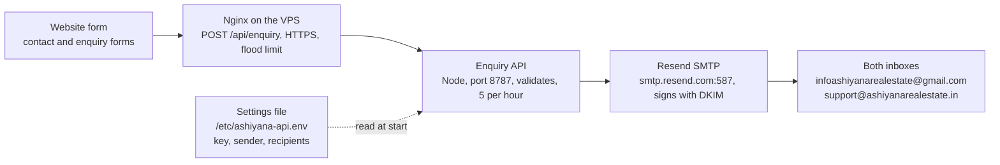

# Ashiyana Website — Email (Enquiry Mail) Setup Guide

As of 31 Oct 2026 · Living copy: https://claude.ai/artifact/VssUwBu84ekzyJH8RkX9X3

## Overview

Every enquiry form on www.ashiyanarealestate.in is emailed to the team through Resend, a transactional email service, using plain SMTP. This has been live since 31 Oct 2026.

- **Sender:** Ashiyana Website <support@ashiyanarealestate.in>
- **Recipients:** infoashiyanarealestate@gmail.com and support@ashiyanarealestate.in (both get every enquiry)
- **Code:** the `api/` folder of this repo, a small Node (Fastify + nodemailer) service
- **No code change is needed to change mail settings.** Everything is configured in one environment file on the server.

This guide never contains the real API key. Ask the project owner for access to the Resend account and the VPS instead.

## How it works



Nginx passes `/api/enquiry` to the API on the same server. The API checks the form and its rate limit, then sends one email through Resend's SMTP to both recipients. All credentials come from the settings file, read when the service starts.

## Configuration reference

All mail settings live in one file on the server: `/etc/ashiyana-api.env` (owner root, permissions 600). The service reads it at start-up, so restart the service after any change.

### Settings

| Setting | Production value | What it does |
| --- | --- | --- |
| `SMTP_HOST` | `smtp.resend.com` | Resend SMTP server. If empty, emails are only logged (and in production the service refuses to start). |
| `SMTP_PORT` | `587` | STARTTLS port. 465 also works with `SMTP_SECURE=true`. |
| `SMTP_SECURE` | `false` | `false` for 587 (STARTTLS), `true` for 465. |
| `SMTP_USER` | `resend` | Always the literal word `resend`. |
| `SMTP_PASS` | *the Resend API key* (`re_…`) | Secret. Sending-only key named `ashiyana-website`, limited to ashiyanarealestate.in. Never commit or paste it. |
| `MAIL_TO` | `infoashiyanarealestate@gmail.com, support@ashiyanarealestate.in` | Recipients, comma-separated. |
| `MAIL_FROM` | `"Ashiyana Website <support@ashiyanarealestate.in>"` | Sender. Must be an address on the verified domain. |
| `NODE_ENV` | `production` | `production` = real emails; anything else without `SMTP_HOST` = log only. |
| `PORT` / `HOST` | `8787` / `127.0.0.1` | Where the API listens; only Nginx can reach it. |
| `SITE_URL` | `https://www.ashiyanarealestate.in` | Used for links inside the email. |
| `RATE_LIMIT_MAX` | `5` | Enquiries allowed per visitor IP per hour. |
| `TRUST_PROXY` | `127.0.0.1` | Trust Nginx's forwarded IP for rate limiting. |
| `LOG_LEVEL` | `info` | Log detail. |

### File and path map

| What | Where |
| --- | --- |
| Live settings (with key) | `/etc/ashiyana-api.env` on the VPS |
| Settings backup before Resend | `/root/ashiyana-api.env.bak-20261031-105527` |
| Settings template (no secrets) | `api/.env.example` in the repo |
| Local settings (your PC) | `api/.env`, git-ignored |
| Mail code | `api/src/server.js` (SMTP transport), `api/src/app.js` (email text, validation, rate limit) |
| Deployed API code | `/opt/ashiyana-api` (previous release in `/opt/ashiyana-api.prev`) |
| Node used by the API | `/opt/ashiyana-node22/bin/node`. Do not touch the system Node 20; other apps use it. |
| Service | systemd unit `ashiyana-api`, file `/etc/systemd/system/ashiyana-api.service`, runs as user `ashiyana-api` |
| Nginx proxy | `location = /api/enquiry` in `/etc/nginx/sites-enabled/ashiyana-production.conf` → `127.0.0.1:8787` |
| Health check | `https://www.ashiyanarealestate.in/api/health` returns `{"ok":true}` |

### Accounts

| Account | Used for | Access |
| --- | --- | --- |
| Resend (resend.com) | Sending, key management, delivery logs | Ask the project owner for an invite |
| GoDaddy | DNS for ashiyanarealestate.in | Project owner only |
| VPS 139.84.147.129 (Vultr) | Server settings and logs | SSH key login as root; ask the owner to add your public key |

## DNS and domain verification

The domain ashiyanarealestate.in is verified in Resend (verified 30 Oct 2026, region Tokyo ap-northeast-1). DNS is managed at GoDaddy (nameservers `ns35/ns36.domaincontrol.com`). **Do not delete these records**, or every email will be rejected.

| Type | Name in GoDaddy | Value | Purpose |
| --- | --- | --- | --- |
| TXT | `resend._domainkey` | `p=MIGfMA0…` (copy the exact value from Resend → Domains → Records) | DKIM: proves Resend may sign mail for the domain |
| CNAME | `send` | `send.forge.rmta.net` | SPF and bounce handling for Resend |
| CNAME | `rsend` | `rsend-apne1.forge.rmta.net` | Resend Forge sending route |
| TXT | `_dmarc` | `v=DMARC1; p=reject; …` | Existing DMARC policy. Mail that fails DKIM is rejected. |
| TXT | `@` | `v=spf1 include:secureserver.net -all` | Existing SPF for the GoDaddy mailbox. Leave it as is; Resend uses the `send` subdomain. |

In GoDaddy, type only the short name (`send`), never `send.ashiyanarealestate.in`, because GoDaddy adds the domain itself.

To check from any PC: `nslookup -type=TXT resend._domainkey.ashiyanarealestate.in` should return the DKIM value.

## Local development setup

On your PC the API runs in **log-only mode** by default: enquiries are printed to the terminal instead of emailed. Use that for everyday work.

1. Install Node 22 or newer.
2. In a terminal (Git Bash or PowerShell), go to the `api` folder of the repo and run `npm ci`.
3. Copy `api/.env.example` to `api/.env`. Leave `SMTP_HOST` empty and do not set `NODE_ENV=production`.
4. Run `npm run dev` (restarts on file changes) or `npm start`. The API listens on `http://127.0.0.1:8787`.
5. Run `npm test` before every commit.
6. To test the form end to end, run the website (`web` folder, `npm run dev`) alongside the API.

To send **real** test emails locally, put the SMTP settings from the configuration table in `api/.env`, using your own test key from the Resend account. Set `MAIL_TO` to your own address so you do not spam the business inboxes. `api/.env` is git-ignored; never rename or commit it. Never put a key in `api/.env.example` — that file is committed.

## Operations

All server commands below are run **on the VPS**, after logging in from Git Bash with `ssh root@139.84.147.129`. They are Linux commands; they will not work in Windows PowerShell.

### Change any mail setting (recipients, sender, key)

1. Back up the file: `cp -p /etc/ashiyana-api.env /root/ashiyana-api.env.bak-$(date +%Y%m%d-%H%M%S)`
2. Edit it: `nano /etc/ashiyana-api.env`, change the line, then save with Ctrl+O, Enter, Ctrl+X.
3. Restart: `systemctl restart ashiyana-api`
4. Check: `journalctl -u ashiyana-api -n 20 --no-pager`. You must see **SMTP connection verified**.
5. Send a test enquiry (below).

### Rotate the Resend API key

1. Resend → API keys → Create API key: name `ashiyana-website`, permission **Sending access**, domain **ashiyanarealestate.in**.
2. Put the new key in `SMTP_PASS` using the steps above, restart and check for **SMTP connection verified**.
3. Send a test enquiry, then delete the old key in Resend.

Rotate immediately if a key is ever pasted into chat, email, a ticket or a commit.

### Send a test enquiry

Use the contact form on www.ashiyanarealestate.in with the name **TEST - please ignore**, or run this from Git Bash on your PC:

```
curl -X POST https://www.ashiyanarealestate.in/api/enquiry -H "Content-Type: application/json" -d '{"name":"TEST - please ignore","phone":"9999999999","intent":"buy","sourcePage":"/contact"}'
```

Expected reply: `{"ok":true}`. The server log then shows `enquiry sent`, Resend → Emails shows **Delivered**, and both inboxes receive it. The limit is 5 enquiries per IP per hour, so do not loop this. Allowed `intent` values: `buy`, `sell`, `rent`, `invest`.

### Logs and checks

| Need | Command or place |
| --- | --- |
| Live API log | `journalctl -u ashiyana-api -f` |
| Is the service running? | `systemctl is-active ashiyana-api` |
| Is the API reachable? | `https://www.ashiyanarealestate.in/api/health` |
| Was an email delivered, bounced or marked spam? | Resend dashboard → Emails |
| Nginx errors | `/var/log/nginx/ashiyana-production.error.log` |

### Deploying API code changes

Code changes in `api/` go out with the normal site deploy: `bash deploy/deploy.sh staging`, then `bash deploy/deploy.sh production`, from Git Bash on the office PC. The deploy never touches `/etc/ashiyana-api.env`, so mail settings survive every deploy. Commit and push after each deploy.

## Troubleshooting

Start with the API log (`journalctl -u ashiyana-api -n 50`), then Resend → Emails.

| Symptom | Likely cause | Fix |
| --- | --- | --- |
| Service won't start: "SMTP_HOST is not set" | `NODE_ENV=production` with an empty `SMTP_HOST` | Fill in the SMTP settings, then restart |
| Log shows an authentication error (535 / invalid API key) | Key deleted, mistyped, or has spaces or quotes around it | Create a new sending key and paste it with nothing around it |
| Resend shows "domain not verified" / 403 | DNS records removed or changed in GoDaddy | Re-add the records from the DNS section and click Verify in Resend |
| Form says it failed; log shows `429` | Rate limit: more than 5 enquiries from one IP within an hour | Wait an hour; this is expected protection |
| Form says it failed; log has no entry | Nginx can't reach the API, or the service is down | `systemctl status ashiyana-api`, then check `/api/health` |
| Resend shows Delivered but no email in the inbox | Spam folder or a Gmail filter | Mark it "Not spam"; check filters |
| Resend shows Bounced | Wrong `MAIL_TO` address or a full mailbox | Fix `MAIL_TO`, or clear the mailbox |
| Emails stopped after a GoDaddy DNS change | DKIM/CNAME records edited or deleted (DMARC is `p=reject`) | Restore the records exactly as listed |
| Nothing works after a change and you need to undo | Bad edit to the settings file | Copy the latest `/root/ashiyana-api.env.bak-*` back to `/etc/ashiyana-api.env`, then restart |

## Security rules and new-joiner checklist

**Rules**

- The API key lives in exactly one place: `SMTP_PASS` in `/etc/ashiyana-api.env`. Never put it in git (including `api/.env.example`), chat, email, screenshots or this document.
- Use **sending-only** keys limited to ashiyanarealestate.in. Never create full-access keys for the server.
- Back up the settings file before every edit.
- The VPS is shared with other business apps. Only touch `ashiyana-*` files and services. Never run `deploy/setup-vps.sh` (it is for an empty server) or upgrade the system Node.
- SSH is key-only. After 2 failed logins, stop: repeated failures get your IP blocked.
- Never edit or delete the DNS records in the DNS section without the project owner.

**Checklist for your first week**

- [ ] Get an invite to the Resend account and open Domains → ashiyanarealestate.in
- [ ] Send your SSH public key to the project owner and confirm `ssh root@139.84.147.129` works
- [ ] Run the API locally in log-only mode and pass `npm test`
- [ ] Read `api/src/server.js` and `api/src/app.js`
- [ ] On the server, view the settings file without the key: `grep -v SMTP_PASS /etc/ashiyana-api.env`
- [ ] Watch the live log during one test enquiry and find it in Resend → Emails
